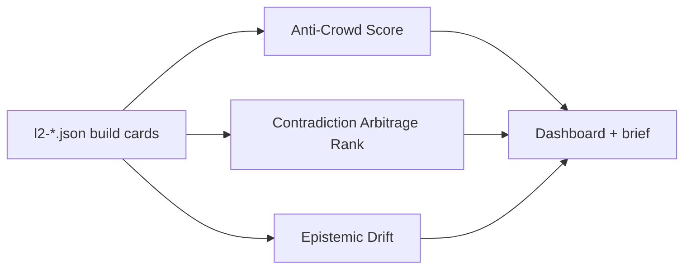

# RIG Pattern Engines

Three analysis engines that read a folder of research cards and surface strategic
signals: crowded opportunities, disputed claims, and concepts on the move. Built for
analysts who want repeatable numbers instead of opinions. No LLM calls, no API keys,
fully offline.

[](https://github.com/mrodgersjs-web/rig-pattern-engines/actions/workflows/ci.yml)
[](LICENSE)
[](https://www.python.org/downloads/)

## Why this exists

Research piles grow fast and nobody re-reads them. These engines turn a folder of
structured research cards into three ranked reports: which opportunity is under-owned,
which claims disagree with each other, and which vocabulary is drifting between
fields. The same cards always produce the same numbers, so results can be diffed,
tested, and trusted.

## The three engines, in plain English

- **Anti-Crowd Score (ACS): is this opportunity worth entering?** Scores each strategy
  zone on how attractive it is relative to how crowded it is, and recommends
  ENTER / WATCH / IGNORE.
- **Contradiction Arbitrage Rank (CAR): which claims disagree?** Finds pairs of cards
  that make opposing claims and ranks the disagreements by how close they are to
  resolving.
- **Epistemic Drift: which vocabulary is on the move?** Measures per zone how much of
  the vocabulary is new, crosses domains, and is arriving fastest, and flags leading
  indicators.

Worked examples with real command output: [docs/engines.md](docs/engines.md).

## How it works



## Quickstart

```bash
git clone https://github.com/mrodgersjs-web/rig-pattern-engines.git
cd rig-pattern-engines
python3 -m venv .venv && . .venv/bin/activate
pip install -e '.[dev]'
rig-anticrowd all --cards-dir tests/fixtures
```

## What it proves

- `pytest -q` exercises every engine against the shipped fixture cards.
- `rig-contradiction status --cards-dir tests/fixtures` prints corpus state.
- Re-running any engine twice on the same cards produces identical scores (report
  headers carry a generation timestamp).

## Project layout

```
rig_pattern_engines/   the three engines plus dashboard and card generator
tests/fixtures/        sample build cards used by tests and examples
examples/run_all.py    runnable walkthrough
docs/                  engine worked examples and architecture notes
```

## Development

```bash
pip install -e '.[dev]'
ruff check .
pytest -q --cov
```

## Contributing, security, license

See [CONTRIBUTING.md](CONTRIBUTING.md), [SECURITY.md](SECURITY.md), and the
[MIT license](LICENSE). The engines never make network calls.

Built by Mike Rodgers · rodgersintelligence.com
