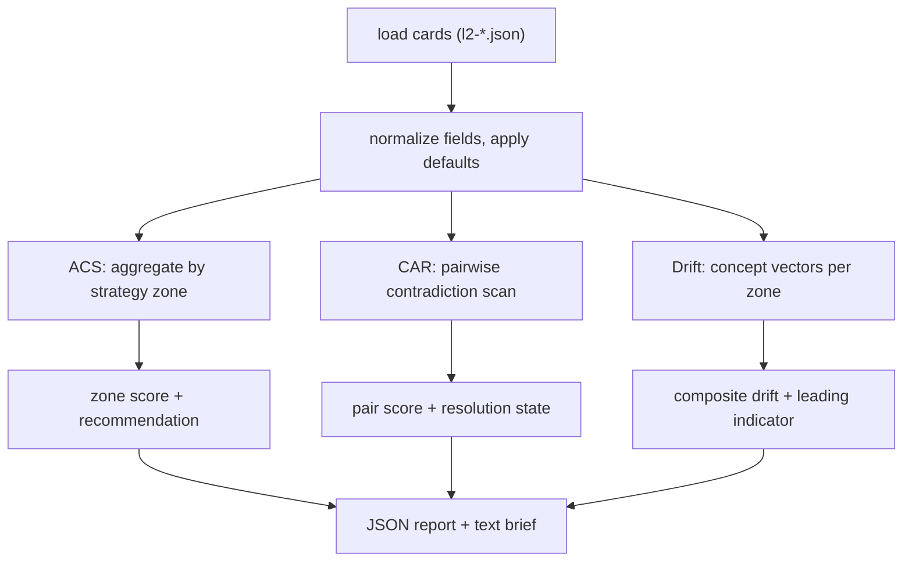

# Architecture

## Design goals

1. **Deterministic.** No LLM calls, no randomness, no wall-clock dependence in scores. The same card corpus always produces the same report, so results can be diffed and tested byte-for-byte.
2. **Offline.** The engines read JSON files from disk and write JSON and text reports back to disk. Nothing opens a socket.
3. **Tolerant input.** A build card is a JSON document with up to 67 fields. The engines never require all of them; missing fields fall back to safe defaults so a partially filled card still scores.

## Module map

| Module | Responsibility |
|--------|----------------|
| `omniscout_build_cards.py` | Shared primitives: card loading, stable JSON serialization, SHA-256 hashing, topic-strategy loading, per-card scoring helpers. |
| `pattern_anticrowd.py` | Anti-Crowd Score. Aggregates cards by strategy zone and scores each zone on market size, competitor concentration (HHI), regulatory burden, revenue potential, build time, and internal coverage. Emits a per-zone record with ENTER / WATCH / IGNORE. |
| `pattern_contradiction.py` | Contradiction Arbitrage Rank. Compares every card pair, detects negation-level disagreement within a shared strategy, and scores each pair with centrality, evidence tension, and resolution-state components. Emits a ranked pair list plus a brief. |
| `pattern_drift.py` | Epistemic Drift. Builds concept co-occurrence and ego vectors per strategy zone, classifies vocabulary as frontier / emerging / established, measures cross-domain bridging and drift velocity, and flags leading indicators. |
| `pattern_dashboard.py` | Combines the three engine reports into one dashboard payload and HTML view. |
| `pattern_generate.py` | Card generator used by tests and examples to synthesize corpora. |

## Scoring pipeline

## Determinism rules

- All serialization goes through `stable_json` (sorted keys), so report files diff cleanly.
- Card ordering is by sorted filename, never filesystem order.
- Scores are plain floats from fixed formulas; there is no sampling or tie-breaking randomness.
- Timestamps appear in report headers only, never inside scores.

## Extension points

To add a scoring dimension to the Anti-Crowd engine, add the field to `compute_acs`, include it in the output record, and cover it with a fixture-based test. The same pattern applies to CAR components and Drift ratios. Each engine keeps its output schema flat and JSON-serializable on purpose: downstream tools can read reports without importing the package.
